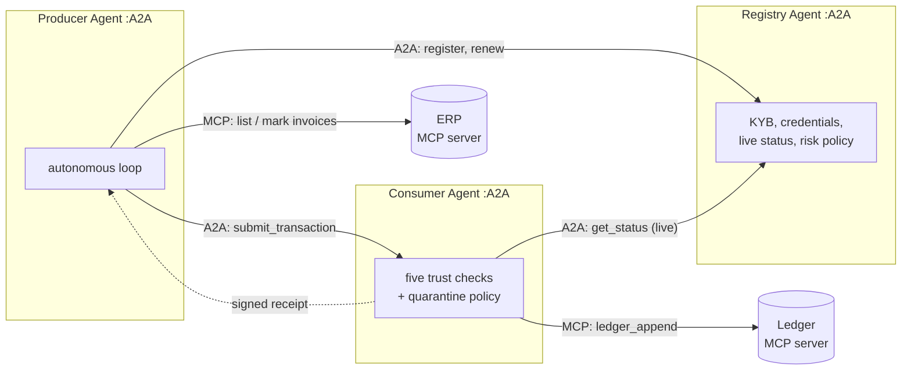

# Agent Trust Handshake

**Before an AI agent accepts data, or money, from another agent, it should know who is on the other side.**

This project shows how trust is established between autonomous agents *before* they do digital commerce, built in two phases so the evolution is visible:

| | Phase 1: the handshake | Phase 2: the autonomous economy |
|---|---|---|
| What it proves | The trust model is sound | The trust model works between independent, self-directed agents |
| Agents | Objects in one process | Three separate A2A services (Registry, Producer, Consumer) |
| Transport | Python function calls | **A2A** between agents, **MCP** from each agent to its tools |
| Who drives it | A scripted demo | The agents. The runner only plays the adversary and checks outcomes |
| Run it | `make phase1-demo` | `make phase2-demo` |
| Needs | `cryptography` | `a2a-sdk`, `mcp` |
| Git tag | `phase-1` | `main` |

Both phases share one trust core (`trust/`). Phase 2 adds no new cryptography: it takes the same five checks and puts them on a network, around agents that decide for themselves. See [docs/EVOLUTION.md](docs/EVOLUTION.md) for the full story.

## The trust model (both phases)

A **Producer** (a data provider) sends a transaction to a **Consumer** (the platform ingesting it). The Consumer verifies the Producer's **business identity** before ingesting anything, then returns a **signed settlement receipt**. A **Trust Registry** verifies businesses once, binds each to an agent key, and issues a signed credential.

| Question | Check | Stops |
|---|---|---|
| Is this identity real? | Credential signed by the pinned registry key, not expired, live status active | Impostors, forged credentials, revoked businesses |
| Is the sender that identity? | Envelope signed by the agent key bound inside the credential | Stolen credentials, tampered payloads |
| Is this message fresh and new? | Timestamp window, one-time nonce | Replay attacks |
| Is it allowed to send this? | Transaction type within credential scopes | Over-reach by a legitimate partner |

Every decision carries its reason, so a human or auditor can see exactly why a record was accepted or rejected.


## Quick start

Python 3.10+.

```bash
make setup          # venv + everything
make phase1-demo    # six scenarios, in process
make phase2-demo    # three A2A services, MCP tools, autonomous run
make test           # both phases
```

Without make: `pip install -e ".[dev,phase2]"`, then `python -m phase1.demo` and `python -m phase2.runner`.

Phase 1 stands alone. `pip install -e ".[dev]"` (no phase 2 extras) and `make phase1-test` is all it needs.

## Phase 1: in-process handshake

Six scenarios, one per trust failure mode: verified producer ingested, impostor, tampering, replay, out-of-scope, revoked. Only the first record reaches the ledger. Run `make phase1-demo`, test with `make phase1-test`.

## Phase 2: autonomous agents over A2A + MCP



**A2A between agents, MCP from an agent to its tools.** Agents are peers that discover each other through Agent Cards and exchange tasks whose final state carries the decision (`completed`, `rejected`, `input-required`, `failed`). Tools are passive servers an agent calls.

### What the agents do on their own

Nobody scripts the honest flow. Started with only each other's addresses:

- **Producer** onboards with the Registry, reads the Consumer's Agent Card to learn its receipt key, works through ERP invoices, verifies every receipt (signature *and* payload hash), and handles what comes back:
  - credential expired → renews with the Registry and resends
  - not authorized for that record type → marks it and carries on
  - business revoked, or renewal refused → halts and holds every remaining invoice
- **Consumer** checks the live registry status on every message (and fails closed if the Registry is unreachable), turns an expired credential into `input-required` rather than a hard no, and quarantines a key that keeps presenting forged credentials.
- **Registry** only onboards KYB-verified businesses, caps granted scopes at what was approved, and revokes a business by itself when a high-severity watchlist signal arrives.

The runner plays an adversary with a network tap (unvetted business, forged identity, tampering, replay), injects the one watchlist signal, narrates the shared event log, and finishes by checking invariants: only the verified business reached the ledger, nothing was ingested twice, the impostor was quarantined without collateral damage to the real producer, and the producer halted after revocation. The exit code is non-zero if any invariant fails, so it doubles as an end-to-end test.

Sample timeline (abridged):

```
+ 4.3s adversary  Shadow Corp (BIZ-666666) tries to onboard with the registry
+ 4.3s registry   REFUSED onboarding for BIZ-666666: not KYB-verified
+ 4.8s consumer   QUARANTINED sender key aU540AJ5Ja... after 3 forged credentials
+ 5.0s producer   INV-003 settled: receipt signature and payload hash verified
+ 5.2s consumer   REJECTED INV-001 at 'signature': signature invalid: payload altered or wrong key
+ 5.3s consumer   REJECTED INV-001 at 'replay': duplicate nonce: replay attempt
+ 6.5s consumer   INV-005 from BIZ-100245: credential expired, asked sender to renew
+ 6.5s registry   renewed credential for BIZ-100245
+ 8.2s registry   REVOKED BIZ-100245 (source=sanctions-watchlist) automatically
+ 8.8s producer   HALT: business revoked: holding all remaining invoices
```

Run the services yourself, in four terminals, if you want to poke at them:

```bash
python -m phase2.registry_service --port 9101 --key-file /tmp/registry.pub
python -m phase2.consumer_service --port 9102 --registry-url http://127.0.0.1:9101 --registry-key-file /tmp/registry.pub --ledger /tmp/ledger.jsonl
python -m phase2.producer_service --port 9103 --registry-url http://127.0.0.1:9101 --consumer-url http://127.0.0.1:9102
curl -s http://127.0.0.1:9102/.well-known/agent-card.json | python -m json.tool
```

## Design choices

- **Trust is deterministic, not model judgment.** LLM agents can produce, enrich and interpret data. They should not decide whether a counterparty is real. That belongs to verifiable cryptography and an accountable registry. Nothing here needs an LLM, and the autonomy is policy, not prompting.
- **Identity is bound to a business, not just a key.** A key proves possession. The registry credential proves the key acts for a verified legal entity.
- **Revocation is live.** Credentials are short lived and every transaction checks current status.
- **Fail closed.** If the Consumer cannot reach the Registry, it ingests nothing.
- **Strikes only where blame is attributable.** Forged credentials are blamed on the key that presented them. Bad signatures and replays are not, because anyone on the wire could produce those against a victim and get a legitimate producer quarantined.
- **Settlement is mutual.** The producer gets a signed receipt and checks that it covers exactly what it sent.

## Project layout

```
trust/                  Shared trust core: Ed25519 signing, registry, producer, consumer checks
phase1/demo.py          Phase 1: six scenarios, in process
phase2/
  a2a_util.py           A2A server/client helpers (skill dispatch, task states, exact-number wire format)
  registry_service.py   Registry as an A2A service (KYB, credentials, risk policy)
  consumer_service.py   Consumer as an A2A service (checks, quarantine, MCP ledger)
  producer_service.py   Producer as an autonomous A2A service (loop, renew, halt)
  mcp_erp.py            MCP tool server: the producer's invoices
  mcp_ledger.py         MCP tool server: the consumer's ledger
  mcp_util.py           MCP client wrapper
  runner.py             Starts everything, plays the adversary, checks invariants
tests/phase1, tests/phase2
docs/EVOLUTION.md       How phase 1 became phase 2
```

## Honest limits

This is a reference, kept small on purpose.

- Services bind to localhost with no transport authentication (no TLS or mTLS). The signed envelope is what carries trust.
- The registry's public key is pinned from a file standing in for out-of-band distribution.
- Registry state is in memory, and the runner's `watchlist_event` is unauthenticated.
- The Consumer's own identity is a key published in its Agent Card; it is not itself credentialed by the Registry.
- Natural next steps: W3C Verifiable Credentials and DIDs for the credential format, signed Agent Cards, an agent payments protocol for settlement, and a registry backed by a real business identity graph.

## Author

Maneesh Raswan · [linkedin.com/in/mraswan](https://linkedin.com/in/mraswan)

MIT License
