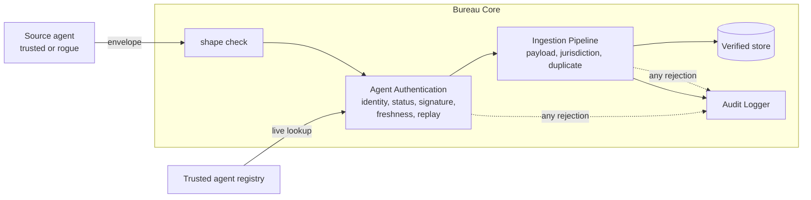
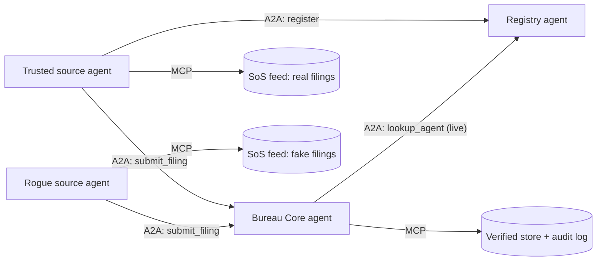

# Agent Trust Handshake

**Before an AI agent accepts data from another agent, it should know who is on the other side.**

This project shows how trust is established between autonomous agents *before* they exchange data, using a concrete slice of a commercial credit bureau: **ingesting Secretary of State business formation filings only from authenticated, verified source agents.** It deliberately stops at the Bureau Core. No scoring, no dashboards.

The founding vision and spec are in [docs/BLUEPRINT.md](docs/BLUEPRINT.md). Everything here is built from it.

## The idea in one walkthrough

1. **Trusted ingestion.** A trusted Secretary of State connector files `Acme Logistics LLC`. The Bureau Core checks the agent against its trusted agent registry, confirms it, stores the filing in the verified store, and audits `SUCCESS`.
2. **Rejected ingestion.** A rogue agent files `Shell Corp Inc`. The Bureau Core challenges its identity token. Verification fails. The filing is rejected immediately and audited `UNAUTHORIZED_SOURCE_REJECTED`.

## Two phases

| | Phase 1: the handshake | Phase 2: autonomous agents |
|---|---|---|
| Proves | The trust model is sound | It holds between independent, self-directed agents |
| Agents | Objects in one process | Four A2A services: registry, Bureau Core, trusted source, rogue source |
| Tools | none | **MCP** tool servers: each source's data feed, the bureau's store and audit log |
| Driven by | A scripted demo | The agents themselves. The runner only injects one risk signal and checks the outcome |
| Run | `make phase1-demo` | `make phase2-demo` |
| Needs | `cryptography` | plus `a2a-sdk`, `mcp` |

Both phases share one trust core in `trust/`. Phase 2 adds no new trust logic: it puts the same Bureau Core on a network, around agents that decide for themselves. **A2A between agents, MCP from an agent to its tools.** How we got here: [docs/EVOLUTION.md](docs/EVOLUTION.md).

## The Bureau Core



The envelope is the blueprint's ingestion schema:

```json
{
  "agent_metadata": {"agent_id": "SOS-CA-CONNECTOR", "auth_token": "<signature>", "timestamp": "2026-10-19T14:02:11.482913+00:00"},
  "business_filing": {"legal_name": "Acme Logistics LLC", "state_filing_id": "C4829301",
                      "formation_date": "2024-03-15", "jurisdiction": "CA"}
}
```

`auth_token` is an Ed25519 signature over `{agent_id, timestamp, business_filing}`. It proves the sender holds the key the registry has on file, and it binds the token to this exact filing, so changing one byte invalidates it.

| Audit status | Meaning |
|---|---|
| `SUCCESS` | Authenticated, valid, in jurisdiction, new. Stored. |
| `UNAUTHORIZED_SOURCE_REJECTED` | Unknown agent, revoked agent, or a token that does not verify |
| `REPLAY_REJECTED` | Stale timestamp, or a token already used |
| `INVALID_PAYLOAD_REJECTED` | Malformed envelope or filing |
| `OUT_OF_JURISDICTION_REJECTED` | Trusted agent filing for a state it is not authorized for |
| `DUPLICATE_FILING_REJECTED` | Already in the verified store |
| `QUARANTINED_SOURCE_REJECTED` | Phase 2: the source was blocked after repeated unauthorized attempts |

Every entry records the check that failed and why.

## Run the demo

Needs Python 3.10+.

```bash
make setup          # one time: creates .venv and installs everything
make phase2-demo    # the autonomous demo, about 7 seconds
```

Other commands: `make phase1-demo` (nine scenarios, in process), `make test` (both phases). Without make: `pip install -e ".[dev,phase2]"`, then `python -m phase2.runner`. Phase 1 stands alone: `pip install -e ".[dev]"` is all it needs.

`make phase2-demo` starts the registry, the Bureau Core, a trusted source agent and a rogue source agent as separate processes, and prints one live timeline of what they do. You do not type anything. The time, the agent, then what it did:

```
+ 1.7s bureau    UNAUTHORIZED_SOURCE_REJECTED  'Shell Corp Inc' from ROGUE-AGENT-7  [identity] agent is not in the trusted registry
+ 1.7s bureau    SUCCESS  'Acme Logistics LLC' from SOS-CA-CONNECTOR  [all] filing ingested into the verified store
+ 3.2s bureau    QUARANTINED ROGUE-AGENT-7 after 3 unauthorized submissions
+ 3.2s bureau    OUT_OF_JURISDICTION_REJECTED  'Cedar Holdings LLC' from SOS-CA-CONNECTOR  [jurisdiction] agent may file for ['CA'], not 'DE'
+ 4.0s rogue     ADAPT: ROGUE-AGENT-7 is blocked: claiming the trusted agent's identity
+ 4.7s bureau    UNAUTHORIZED_SOURCE_REJECTED  'Vapor Holdings Corp' from SOS-CA-CONNECTOR  [signature] auth_token invalid: wrong key, or the filing was altered
+ 5.4s rogue     GIVE UP: every route is blocked: stopping
+ 5.5s registry  REVOKED SOS-CA-CONNECTOR (source=sanctions-watchlist, severity=high) automatically
+ 6.2s trusted   HALT: bureau no longer accepts this identity (status): holding all remaining filings
```

The first two lines are the blueprint walkthrough: the rogue's `Shell Corp Inc` is refused while the trusted agent's `Acme Logistics LLC` goes through. The run then ends with what the bureau holds and a verdict:

```
Verified store (written through the MCP store tool)
  C4829301  Acme Logistics LLC (CA, formed 2024-03-15)  via SOS-CA-CONNECTOR
  C4829302  Birch Freight Inc (CA, formed 2024-04-02)  via SOS-CA-CONNECTOR
  C4829304  Elm Partners LP (CA, formed 2024-05-21)  via SOS-CA-CONNECTOR
  C4829305  Fjord Imports Corp (CA, formed 2024-06-30)  via SOS-CA-CONNECTOR

Audit log
  UNAUTHORIZED_SOURCE_REJECTED   6
  SUCCESS                        4
  OUT_OF_JURISDICTION_REJECTED   1
  QUARANTINED_SOURCE_REJECTED    1
  INVALID_PAYLOAD_REJECTED       1

Invariants
  PASS  every filing in the verified store came from the trusted agent
  PASS  nothing the rogue agent submitted reached the verified store
  PASS  the rogue's own identity was rejected as unauthorized, then quarantined without an operator
  ... (11 in all)

All invariants held.
```

**What an invariant is.** A statement that must be true however the run unfolds, whatever the timing. "Nothing the rogue submitted reached the verified store" is one. The agents act on their own, so no two runs are identical, and the runner cannot compare against a fixed expected output. Instead it checks these statements against the audit log and the store when the run ends. If any fails, it prints `INVARIANT FAILURE` and exits non-zero, which is how the same demo works as an end-to-end test in CI.

## Phase 2: what the agents do on their own



Nobody scripts the behaviour. Started with only each other's addresses:

- **Trusted source** registers its key with the registry, works through its feed, and reacts to each answer: ingested, or refused (wrong jurisdiction, invalid payload) and carries on, or, if the bureau stops accepting its identity, **halts and holds every remaining filing**.
- **Rogue source** has no registration and cannot get one. It submits fake filings, and when the bureau blocks it, **it adapts**: it claims the trusted agent's identity instead. That fails the signature challenge, so it gives up.
- **Bureau Core** asks the registry for live status on every submission and **fails closed** if it cannot. It **quarantines** an agent_id the registry has never heard of after three attempts.
- **Registry** only registers sources the bureau vetted, one key per agent_id, and **revokes by itself** when a high-severity watchlist signal arrives.

The runner finishes by checking the invariants described in [Run the demo](#run-the-demo).

To run the services yourself in separate terminals:

```bash
python -m phase2.registry_service --port 9101
python -m phase2.bureau_core --port 9102 --registry-url http://127.0.0.1:9101 --store-dir /tmp/bureau
python -m phase2.source_agent --mode trusted --port 9103 --registry-url http://127.0.0.1:9101 --bureau-url http://127.0.0.1:9102
python -m phase2.source_agent --mode rogue   --port 9104 --registry-url http://127.0.0.1:9101 --bureau-url http://127.0.0.1:9102
curl -s http://127.0.0.1:9102/.well-known/agent-card.json | python -m json.tool
```

## Design choices

- **Trust is deterministic, not model judgment.** LLM agents can produce and interpret filings. They should not decide whether a source is real. That belongs to cryptography and an accountable registry. Nothing here needs an LLM; the autonomy is policy.
- **Identity is checked live.** Revoking an agent in the registry takes effect on its next submission.
- **Fail closed.** If the Bureau Core cannot reach the registry, it ingests nothing.
- **Strikes only where blame is attributable.** Only an unknown agent_id earns quarantine strikes. A bad signature under a *known* id does not, because anyone could claim a trusted agent's id and get it blocked.
- **Authentication before content.** The bureau never looks at a filing until the sender is authentic.

## Project layout

```
docs/BLUEPRINT.md       The founding spec, with a blueprint-to-code traceability table
trust/                  Shared core
  registry.py             Trusted agent registry
  source_agent.py         Builds and signs an envelope
  auth.py                 Agent Authentication Module
  ingestion.py            Ingestion Pipeline (schema validation, jurisdiction, duplicates)
  audit.py                Audit Logger and the status vocabulary
  bureau.py               Bureau Core: wires the three together
  crypto.py               Ed25519 signing, canonical JSON
phase1/demo.py          Nine scenarios, in process
phase2/                 Phase 2: A2A services and MCP tool servers
  registry_service.py     Registry as an A2A agent (vetting, one key per id, risk policy)
  bureau_core.py          Bureau Core as an A2A agent (live lookup, fail closed, quarantine)
  source_agent.py         Trusted or rogue source, autonomous (--mode)
  mcp_sos_feed.py         MCP tool server: a source's filings
  mcp_bureau_store.py     MCP tool server: verified store and audit log
  a2a_util.py, mcp_util.py, runner.py
tests/phase1, tests/phase2
```

## Honest limits

This is a reference, kept small on purpose.

- Services bind to localhost with no transport security. The signed `auth_token` is what carries trust.
- Agents register their own public key, gated by a vetted list; a real bureau would provision keys out of band. Registry state is in memory, and `watchlist_event` is unauthenticated.
- Quarantine is by claimed agent_id; there is no network-level identity of the caller.
- Natural next steps: W3C Verifiable Credentials and DIDs for agent identity, signed Agent Cards, per-source rate limits, and the parts the blueprint excluded (scoring, aggregation, lender dashboards).

## Author

Maneesh Raswan · [linkedin.com/in/mraswan](https://linkedin.com/in/mraswan)

MIT License
