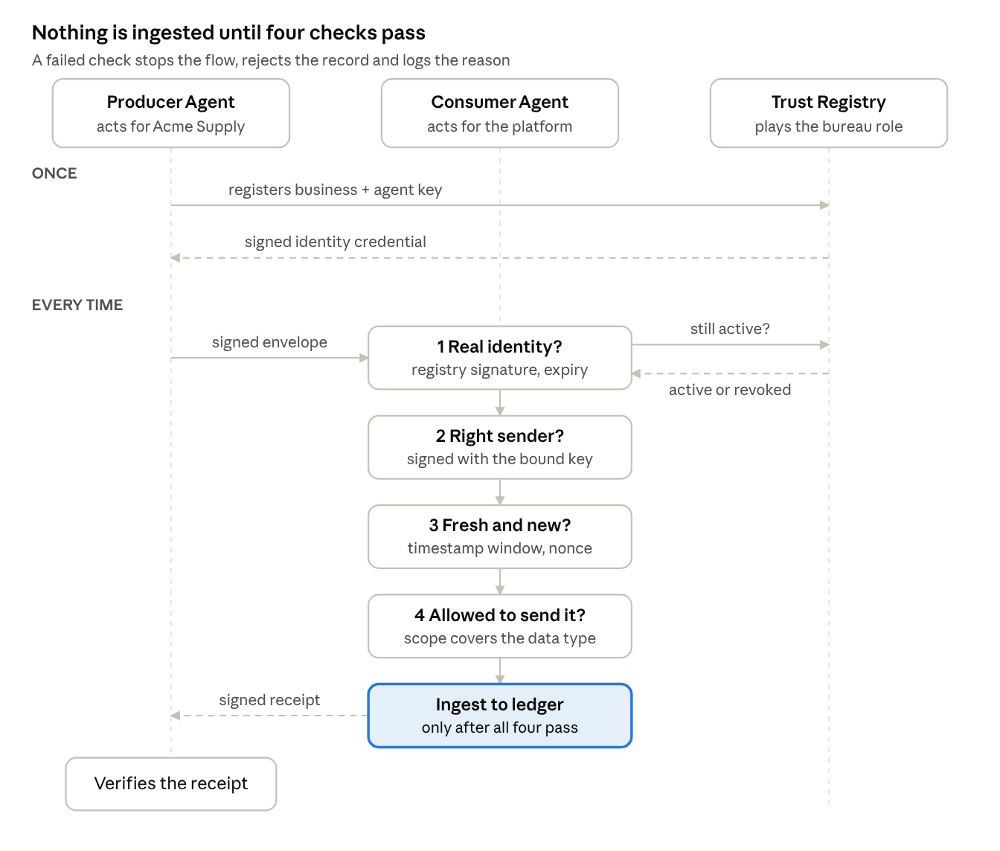
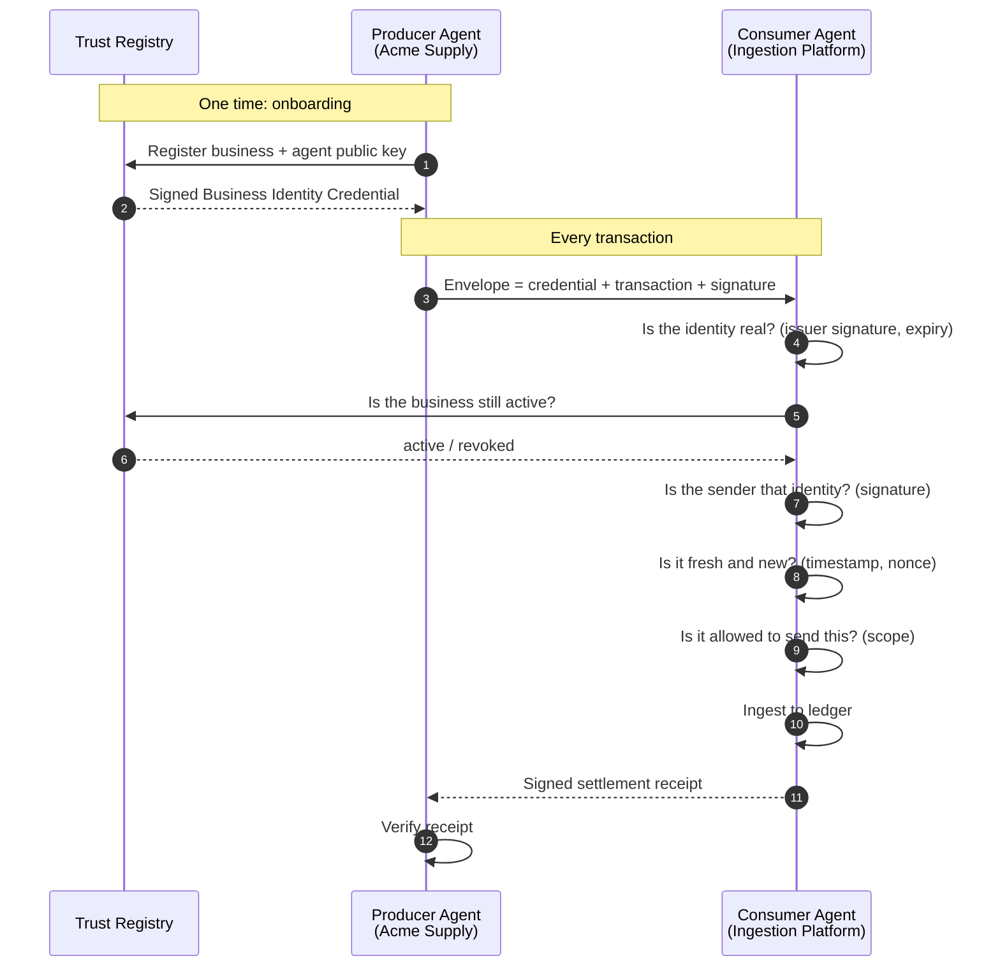

# Agent Trust Handshake

**Before an AI agent accepts data from another agent, it should know who is on the other side.**

This is a minimal, runnable reference for agent-to-agent trust. A **Producer Agent** (a data provider) sends a transaction to a **Consumer Agent** (the platform ingesting it). The consumer verifies the producer's **business identity** before ingesting anything, then returns a **signed settlement receipt**.

The pattern mirrors how a commercial credit bureau onboards thousands of data contributors: verify the business once, bind it to a credential, and check every submission against that identity. Here, the contributors are agents.

## The flow





## Four questions the consumer answers

| Question | Check | Stops |
|---|---|---|
| Is this identity real? | Credential signed by the pinned registry key, not expired, live status active | Impostors, forged credentials, revoked businesses |
| Is the sender that identity? | Envelope signed by the agent key bound inside the credential | Stolen credentials, tampered payloads |
| Is this message fresh and new? | Timestamp window, one-time nonce | Replay attacks |
| Is it allowed to send this? | Transaction type within credential scopes | Over-reach by a legitimate partner |

Every decision is logged with its reason, so a human or auditor can see exactly why a record was accepted or rejected.

## Run it

Requires Python 3.10+.

```bash
make setup   # creates .venv and installs the package with dev dependencies
make demo    # runs the six scenarios
make test    # runs the test suite (12 tests)
```

Or without make: `pip install -e ".[dev]"`, then `python demo.py` and `pytest -q`.

The demo runs six scenarios:

1. Verified producer sends a trade payment: **ingested and settled**
2. Impostor uses a self-issued credential: **rejected at issuer check**
3. Amount altered in transit: **rejected at signature check**
4. Same message replayed: **rejected at replay check**
5. Verified producer sends an unauthorized data type: **rejected at scope check**
6. Business revoked in the registry: **rejected at status check**

Only the first record reaches the ledger.

## Design choices

- **Trust is deterministic, not model judgment.** LLM agents can produce, enrich, and interpret data. They should not decide whether a counterparty is real. That decision belongs to verifiable cryptography and an accountable registry.
- **Identity is bound to a business, not just a key.** A key proves possession. The registry credential proves that the key acts for a verified legal entity.
- **Revocation is live.** Credentials are long lived for performance, but every transaction checks current status, the same way a bureau flags a business that has changed.
- **Settlement is mutual.** The producer gets a signed receipt with the payload hash, so both sides hold proof of what was accepted.

## Project layout

```
trust/
  crypto.py     Ed25519 signing, canonical JSON, hashing
  registry.py   Trust Registry: verifies businesses, issues credentials, live status
  producer.py   Producer Agent: signs envelopes, verifies receipts
  consumer.py   Consumer Agent: four-question verification, ledger, receipts
demo.py         Six scenarios end to end
tests/          One test per trust failure mode
pyproject.toml  Packaging and pytest config
Makefile        setup, demo, test shortcuts
.github/        CI: tests and demo on Python 3.10, 3.12, 3.13
```

## What this is not (yet)

This is a teaching reference, kept small on purpose. Natural next steps:

- W3C Verifiable Credentials and DIDs in place of the custom credential format
- Transport over A2A or MCP
- Settlement over an agent payments protocol
- Registry backed by a real business identity graph and entity resolution

## Author

Maneesh Raswan · [linkedin.com/in/mraswan](https://linkedin.com/in/mraswan)

MIT License
